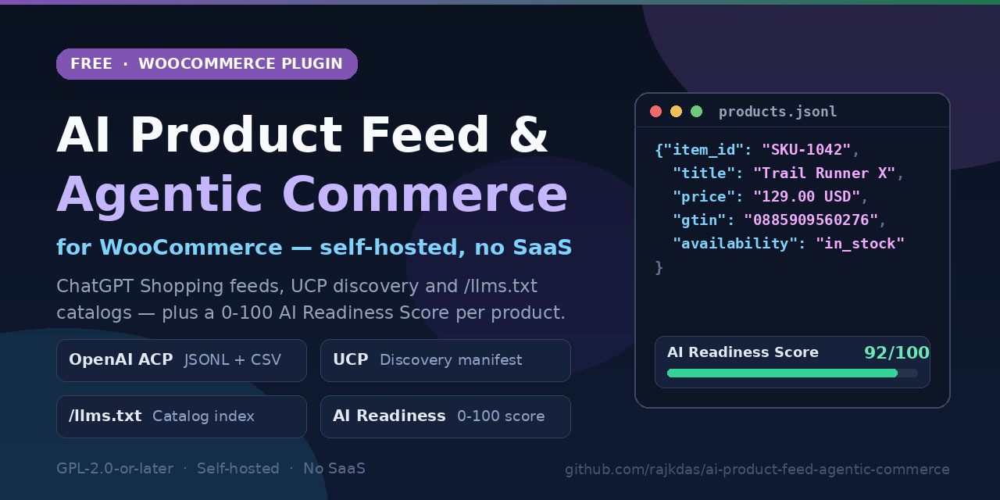

# AI Product Feed & Agentic Commerce for WooCommerce



[](https://github.com/rajkdas/ai-product-feed-agentic-commerce/actions/workflows/lint.yml)


Free, 100% self-hosted WooCommerce plugin that makes a store's catalog readable, recommendable, and buyable by AI agents. It generates OpenAI ACP / ChatGPT Shopping product feeds (JSONL & CSV), publishes UCP discovery manifests for Google AI Mode, serves the `/llms.txt` family for assistants, scores every product with a deterministic 0-100 AI Readiness Score, and monitors the eight AI crawlers that matter. No SaaS, no API keys, no product caps, no storefront impact.

- **WordPress.org listing:** https://wordpress.org/plugins/ai-product-feed-agentic-commerce/ (live after approval)
- **Requirements:** WordPress 6.5+, WooCommerce 7.6+, PHP 7.4+
- **Compatibility:** HPOS (Custom Order Tables) and Cart/Checkout Blocks declared via WooCommerce `FeaturesUtil`
- **License:** GPL-2.0-or-later

<!-- WordPress.org badges - uncomment after the plugin is approved:
[](https://wordpress.org/plugins/ai-product-feed-agentic-commerce/)
[](https://wordpress.org/plugins/ai-product-feed-agentic-commerce/)
[](https://wordpress.org/plugins/ai-product-feed-agentic-commerce/)
-->

## Architecture

```text
WooCommerce catalog (WC_Product CRUD)
        |
        v
ACPFW_Product_Mapper
  |-- flattens variable products: one row per purchasable variation, unique option combinations only
  |-- resolves identity: GTIN / UPC / EAN / ISBN / MPN / brand (WooCommerce core, Yoast, Rank Math,
  |   Germanized, or any custom meta key, with Modulo-10 GTIN check-digit validation)
  |-- resolves images: WebP/AVIF -> underlying JPEG/PNG so ChatGPT carousels never skip a row
  |-- prices through wc_get_price_to_display(): feeds carry the same amounts the storefront shows
        |
        +--> wp-content/uploads/acpfw-feeds/openai-feed-<token>.jsonl   OpenAI ACP feed
        +--> wp-content/uploads/acpfw-feeds/openai-feed-<token>.csv     same rows as CSV
        +--> /llms.txt            short store index for assistants
        +--> /llms-full.txt       full catalog: SKU, price, stock, variation matrix, deep links
        +--> /llms-commerce.txt   shipping, returns, payments
        +--> /.well-known/acp.json    ACP discovery manifest (OpenAI)
        +--> /.well-known/ucp         UCP discovery manifest (Google / Shopify, date-versioned)
        +--> /wp-json/acpfw/v1/ucp/catalog/search   UCP catalog search endpoint
        |
        v
ACPFW_Readiness_Scorer -> 0-100 badge per product in Products > All Products
```

Everything writes atomically as static files and is served straight from disk. Generation runs on a schedule (WP-Cron, an external cron URL, or a manual button) and never inside a shopper's request.

## What the output enforces

- **Spec-perfect rows.** Every purchasable variation becomes its own feed row, linked to the parent `group_id`, with a `variant_dict` whose options always match the row's top-level attributes and deep-link URL. Identical option combinations inside one product are exported once.
- **Same eligibility everywhere.** Grouped containers, unpriced simples, external/affiliate items, hidden, search-only and password-protected products are excluded by the same rules across the JSONL feed, the CSV feed, `/llms-full.txt` and the REST catalog.
- **Strict parsing.** Plain UTF-8, no BOM, HTML-entity decoded titles and descriptions, short-description fallback when the long description is empty.
- **Sale pricing.** Regular and sale amounts are exported side by side; variable products price from the cheapest purchasable variation's raw catalog price, passed through the display-price layer exactly once.

## Repository layout

```text
ai-product-feed-agentic-commerce.php   Bootstrap: constants, activation, WooCommerce-missing notice
includes/class-plugin-core.php         Engine: rewrite rules, schedules, module loading, cron
includes/class-files.php               WP_Filesystem gateway for every file operation
includes/Feeds/                        Product mapper, OpenAI JSONL/CSV generator, image resolver
includes/Discovery/                    llms.txt family, ACP/UCP manifests, REST catalog, schema extender
includes/Scoring/                      Deterministic 7-point readiness scorer
includes/Admin/                        Dashboard, product metabox, list column, environment checks
assets/                                Admin-only CSS/JS (nothing loads on the storefront)
languages/                             ai-product-feed-agentic-commerce.pot
.wordpress-org/                        Six 1200x900 listing screenshots (export-ignored)
phpcs.xml                              WordPress Coding Standards ruleset (dev only)
.github/workflows/lint.yml             CI: php -l on PHP 7.4 / 8.1 / 8.3 + CSS brace balance
```

## Quick start

1. **Install** - Plugins > Add New, search for "AI Product Feed & Agentic Commerce", or upload the zip and activate.
2. **Wizard** - Open WooCommerce > Agentic AI Feed and complete the 3-step setup: map Brand and GTIN sources, set seller name and return policy URL, generate the first feed.
3. **Submit** - Copy the hosted JSONL/CSV URL into OpenAI merchant onboarding for ChatGPT Shopping.
4. **Polish** - Work through the AI Readiness Score badges in Products > All Products.

## Configuration reference

Settings live in the `acpfw_settings` option (WooCommerce > Agentic AI Feed > Settings):

| Key | Purpose | Default |
| --- | --- | --- |
| `seller_name` | Seller display name in feeds and manifests | Site title |
| `return_policy_url` | Return policy link for `/llms-commerce.txt` and Product schema | empty |
| `shipping_summary` | Shipping terms quoted verbatim by assistants | empty |
| `logo_url` | Manual override for the manifest merchant logo | empty |
| `default_brand` | Store-wide fallback brand when a product has none | empty |
| `brand_source` | `auto` or a specific meta key | `auto` |
| `gtin_source` | Meta key holding the GTIN | `_global_unique_id` |
| `mpn_source` | Meta key holding the MPN | empty |
| `mpn_sku_fallback` | Use the SKU as MPN when missing | `no` |
| `enable_llms_txt` | Publish the `/llms.txt` family | `yes` |
| `enable_acp_json` | Publish `/.well-known/acp.json` | `yes` |
| `enable_ucp` | Publish `/.well-known/ucp` + REST search | `yes` |
| `uninstall_cleanup` | Remove all stored data on uninstall | `no` |

Per-product controls live in the **AI Product Feed (Agentic Commerce)** metabox: readiness checks, brand and availability overrides, condition/gender/age-group fields, an exclude-from-all-AI-channels toggle, and conversational Q&A published as `FAQPage` JSON-LD and quoted verbatim in `/llms-full.txt`.

## Hooks and filters

| Hook | Signature | Purpose |
| --- | --- | --- |
| `acpfw_feed_row` | `apply_filters( 'acpfw_feed_row', $row, $product, $parent )` | Modify any feed row before export |
| `acpfw_feed_brand` | `apply_filters( 'acpfw_feed_brand', $default, $product_id )` | Override brand resolution |
| `acpfw_feed_image_url` | `apply_filters( 'acpfw_feed_image_url', $url, $attachment_id )` | Override image resolution |
| `acpfw_acp_manifest` | `apply_filters( 'acpfw_acp_manifest', $manifest )` | Extend the ACP manifest |
| `acpfw_ucp_manifest` | `apply_filters( 'acpfw_ucp_manifest', $manifest )` | Extend the UCP manifest |
| `acpfw_merchant_logo` | `apply_filters( 'acpfw_merchant_logo', $url )` | Override merchant logo resolution |
| `acpfw_return_window_days` | `apply_filters( 'acpfw_return_window_days', 30 )` | Return window used in schema |
| `acpfw_schema_shipping_rate` | `apply_filters( 'acpfw_schema_shipping_rate', null, $product_id )` | Provide shipping rates for Product JSON-LD |
| `acpfw_client_ip` | `apply_filters( 'acpfw_client_ip', $ip )` | Pass the real client IP through a CDN/proxy to the rate limiter |
| `acpfw_feeds_generated` | `do_action( 'acpfw_feeds_generated', $stats )` | Fires after every successful rebuild |

## REST endpoint

```bash
curl "https://example.com/wp-json/acpfw/v1/ucp/catalog/search?q=shoes&page=1&per_page=20"
```

Read-only catalog search over the same rows the feeds export. `q`, `page` and `per_page` are supported; empty-query browsing (pages 1-10) is cached, and the endpoint is rate-limited. Variable listings carry `group_id`, `listing_has_variations` and `purchasable_variants`.

## AI crawler monitor

The dashboard scans the effective `robots.txt` output and live-probes `/llms.txt` plus the feed URL, reporting per-bot status for GPTBot, OAI-SearchBot, ChatGPT-User, PerplexityBot, ClaudeBot, Google-Extended, CCBot and Amazonbot - so a security plugin or firewall never silently costs visibility.

## Troubleshooting

| Symptom | Cause | Fix |
| --- | --- | --- |
| A product is missing from the feed | Grouped container, unpriced simple, external/affiliate item, hidden or password-protected visibility, or zero exportable variations - the same eligibility rules apply everywhere | Give it a price, check catalog visibility, and confirm the exclude toggle in the AI Product Feed metabox |
| ChatGPT drops product images | The uploaded image has no JPEG/PNG original behind the WebP/AVIF rendition | Re-upload with a JPEG/PNG original; the resolver maps WebP/AVIF to the underlying original automatically |
| `/llms.txt` is not served by the plugin | A physical `/llms.txt` in the web root wins, and Yoast SEO / Rank Math own the route when active | Remove or rename the physical file and re-save Settings > Permalinks, or let the SEO plugin own `/llms.txt` while the plugin appends its commerce appendix |
| Feed or discovery URLs return 404 | Rewrite rules not registered on the install | Save Settings > Permalinks (this also flushes after activation) |
| Scheduled rebuilds never fire | WP-Cron disabled or a low-traffic site sleeping | Enable WP-Cron, or call the external cron URL from real cron - token accepted via `X-ACPFW-Token` header or POST field |

## Explicitly left out (v1)

- No order or checkout integration - the plugin publishes catalog and discovery data; purchases started in ChatGPT are completed through OpenAI's ACP checkout, not on your WordPress install.
- No Google Merchant Center XML - a different protocol for a different channel; dedicated shopping-feed plugins cover it.
- No SaaS, accounts, API keys or per-row pricing - the plugin's only HTTP calls are loopback checks to the site it runs on.
- No storefront asset loading - zero front-end scripts or styles, zero catalog queries on shopper page loads.

## Development

```bash
# Coding standards (WordPress-Core, WordPress-Docs, WordPress-Extra)
phpcs --standard=phpcs.xml .

# CI (GitHub Actions) runs on every push to main and every pull request:
#   php -l across the tree on PHP 7.4, 8.1 and 8.3, plus a CSS brace-balance check.

# Build the WordPress.org distribution zip exactly as submitted:
git archive --format=zip --prefix=ai-product-feed-agentic-commerce/ \
    -o ai-product-feed-agentic-commerce-1.0.0.zip HEAD
```

`.gitattributes` export-ignores development files (`.github/`, `phpcs.xml`, `.wordpress-org/`, `.gitattributes`), so GitHub's "Download ZIP" produces the same clean package as the build command.

## License and trademarks

GPL-2.0-or-later. This is an independent plugin: not affiliated with, endorsed by, or sponsored by OpenAI, Google, Anthropic, Perplexity, Shopify, Automattic, or WooCommerce. All product names and trademarks belong to their respective owners and are used only to describe compatible protocols and destinations.

## About

Built and maintained by [Raj Kumar Das](https://github.com/rajkdas). Bug reports and pull requests are welcome at https://github.com/rajkdas/ai-product-feed-agentic-commerce/issues.
